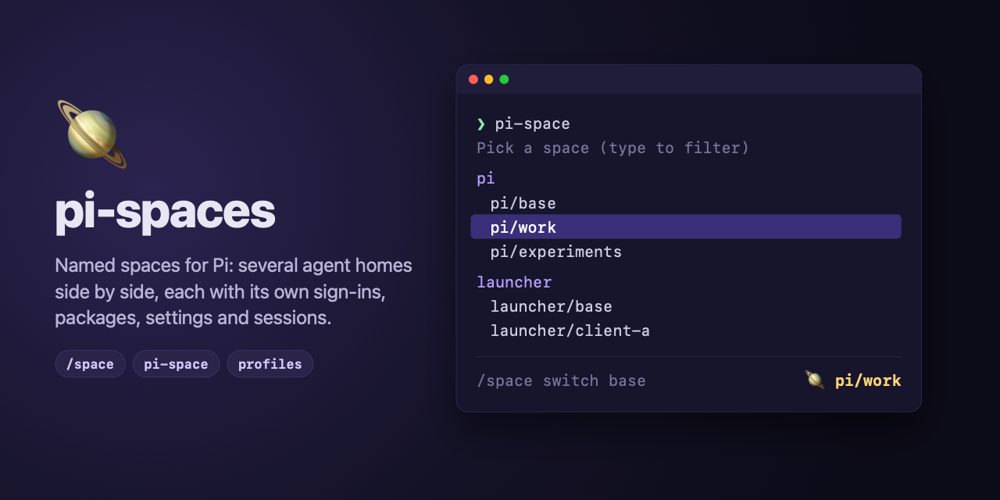

# 🪐 pi-spaces



Named spaces for [Pi](https://pi.dev): keep several agent homes side by side and switch between them from inside Pi.

A space is a complete Pi agent home: its own sign-ins, packages, settings, skills and sessions. Use one per client, per experiment, or to try a package without touching your everyday setup. A space is a root folder with its agent home, `agent`, inside it, like Pi's own `~/.pi/agent`, so a program that keeps more per space has room for it next to `agent/`.

```text
/space new work          Created space "work" at ~/.pi/spaces/work (its agent home is ~/.pi/spaces/work/agent).
/space                   Switch to space
                         → base
                           work
                         Pi restarts in "work"; the status line shows space: work
```

It relies only on Pi's own `PI_CODING_AGENT_DIR` variable, so it works with plain Pi and with any program that runs Pi.

## Requirements

- Pi 1.4 or later.

## Install

```sh
pi install npm:@jals1212/pi-spaces
```

That adds `/space` and the `--space` option to Pi. A program that runs Pi with its own home installs it the same way, through its own install command.

The `pi-space` shell command is optional and is a separate package, so it is installed and updated on its own; `pi install` does not put commands on your `PATH`, so it comes from npm:

```sh
npm install -g @jals1212/pi-spaces-cli
```

## Quick start

```text
/space new work          create a space
/space                   pick a space; Pi restarts in it
/space switch base       back to the home Pi started with
```

From your shell:

```sh
pi --space work                         # start Pi in "work"
pi --space work "review this branch"    # with a prompt
pi-space new pi/work                    # create a space of the profile "pi" (optional CLI)
pi-space remove pi/work                 # delete it, after asking; keeps a backup unless told not to (optional CLI)
pi-space update --every                 # update the packages of base and of every space of every profile (optional CLI)
pi-space                                # pick a space of any profile: arrows, Enter, type to filter (optional CLI)
```

A new space is a folder with an `agent/` folder inside it, empty except for `agent/settings.json`, which declares this package so `/space` works inside it. Sign in and install packages there as you would in a fresh Pi. Spaces made by an older version have no `agent/` folder and keep working as they are; see [Moving an old space](#moving-an-old-space).

## Commands in Pi

| Command | What it does |
| --- | --- |
| `/space` | Opens a list of the other spaces and restarts Pi in the one you pick. Without the interactive terminal it lists them instead. |
| `/space list` | Lists `base` and every space, with `*` on the active one. |
| `/space new <name>` | Creates an empty space (its folder, with `agent/` inside). When a setup command is set (the profile's `commands.setup`, or `PI_SPACES_SETUP`), it names `pi-space setup <profile>/<name>` to run from a shell, with this Pi's profile (`pi` when none matches). |
| `/space switch <name>` | Restarts Pi in that space. `base` is the home Pi started with. |
| `/space switch` | Same as `/space`. |
| `/space rename <old> <new>` | Renames a space. The active space cannot be renamed. |
| `/space remove <name> [--yes] [--no-backup]` | Deletes a space after asking, then asks whether to keep a backup in `<spaces folder>/.backups` (keeping one is first in the list; dismissing the question keeps the space). `--yes` skips the questions and keeps a backup; it is required without a dialog (print and JSON modes). `--no-backup` deletes without one. |
| `pi --space <name>` | Starts Pi directly in a space, keeping the prompt and every other option. |
| `pi --space <name> <command> [args...]` | Runs one of Pi's package commands (`install`, `remove`, `uninstall`, `update`, `list`) in a space, or in the base home with `base`: `pi --space work update --extensions`, `pi --space work install npm:<package>`. |

The status line shows `🪐 <profile>/<name>` while a space is active: the name `pi-space` takes, with the [profile](#profiles) of the running Pi (`pi` when no profile matches its base home), so `🪐 launcher/work` and `🪐 pi/work` are told apart. `/space` cannot change the profile: a switch starts the same program again. In the base home it shows `🪐 <profile>/base` when pi-spaces opened it (`pi --space base`, `pi-space pi/base`, or `/space switch base`), and nothing when Pi was started plainly. 🪐 is pi-spaces' own emoji.

Choosing an argument such as `switch` from the `/space ` suggestions only fills the line; press Enter again to run it. `/space` and Enter opens the picker in one step.

**Names**: lowercase letters, digits, `-` and `_`, starting with a letter or digit, at most 64 characters. `base` is reserved, and so are the command words `list`, `new`, `remove`, `rename`, `switch`, `update`, `install`, `uninstall`, `setup` and `completion`.

## The `pi-space` command

The optional `@jals1212/pi-spaces-cli` package adds a `pi-space` command to your shell. It names every space as `<profile>/<name>` (`pi/work`, `my/base`): the profile is an entry of the [config file](#profiles), and `pi` (plain Pi) is always there. `pi-space` opens a picker of the spaces of every profile and starts Pi in the one you choose, `pi-space <profile>/<name> [pi args...]` starts Pi in a named space, `pi-space new <profile>/<name>` creates one, `pi-space rename <profile>/<old> <new>` renames one, `pi-space remove <profile>/<name>` deletes one, `pi-space migrate <profile>/<name|--every>` gives an old space the [`agent/` layout](#moving-an-old-space), and `pi-space list` lists every profile's spaces. `pi-space list|update|install|uninstall <profile>/<name|--every> ...` runs Pi's package commands in a space, in a profile's spaces, or (`--every` alone) in every profile's. The profile says which program to run, where its spaces live and how to prepare a new space; `--command`, `--dir` and `--setup` override those for one call, for one named profile. `pi-space setup <profile>/<name|--every>` runs the setup command again. `pi-space init` writes a starter config file. A profile's `commands.space` with `{home}` is run directly in the space's home instead (`pi-space launcher/work --version` runs `my-launcher --home <that home> --version`), and `pi-space <profile>/base` runs `commands.base` as it is (`my-launcher`; see [Profiles](#profiles)). The command does not read `PI_SPACES_COMMAND`, `PI_SPACES_DIR` or `PI_SPACES_SETUP` as settings: they are what it hands to the Pi it starts. Unless the profile's space command has `{home}` or `{name}`, it only runs `pi --space <name> [command]`, so this extension must be installed in the home it opens. See [`cli/README.md`](cli/README.md) for the commands, the options and the exit status.

## Profiles

A **profile** describes one program that runs Pi (plain Pi is one too): where its agent home is, the commands that start it, where its spaces live, how to prepare a new space, and the variables it needs per space. Profiles live in an optional file, in TOML or JSON, so you do not need shell variables or functions to tell pi-spaces about a program. Without the file, nothing changes: this is exactly how pi-spaces behaves without any configuration.

The extension uses the profile whose `home` is the base home Pi started with (the one `base` goes back to); inside a space that is the home the space came from. The optional `pi-space` command ([`cli/README.md`](cli/README.md)) reads the same file, and the profile is the first word of every space it takes: `pi-space ml/work`. It does not use `default`: the profile is always named.

### The file

| | |
| --- | --- |
| Location | The first that exists of `$XDG_CONFIG_HOME/pi-spaces/config.toml`, `$XDG_CONFIG_HOME/pi-spaces/config.json`, `~/.pi-spaces/config.toml` and `~/.pi-spaces/config.json` (`XDG_CONFIG_HOME` unset, blank or relative means `~/.config`, so `~/.config/pi-spaces/config.toml`: easy to keep in your dotfiles); with none, `~/.pi-spaces/config.toml`, where `pi-space init` writes. On Windows `~` is `%USERPROFILE%` (`C:\Users\<you>\.config\pi-spaces\config.toml`). The first file found wins. When `config.toml` and `config.json` are in the same folder, `config.toml` is read and a warning names the `config.json` that is ignored (remove one of them). Nothing moves or creates any file. |
| Format | TOML when the file name ends in `.toml`, else JSON (with comments). Both have the same keys and the same checks; a JSON object is a TOML table. |
| Change it | `PI_SPACES_CONFIG=<path>` (a leading `~` is your home folder; a relative path is taken from it). The `pi-space` command also takes `--config <path>` (see [`cli/README.md`](cli/README.md)). |
| Missing | No profiles: Pi, spaces and `pi-space` behave as without this feature. |
| Invalid | See [When the file is wrong](#when-the-file-is-wrong). |

A complete example for a program called `my-launcher`, which keeps its own configuration outside its agent home:

```toml
schema = "pi-spaces.config/v2"

[profiles.ml]
home = "~/.my-launcher/agent"
spaceEnv = { MY_LAUNCHER_CONFIG_HOME = "{home}/config" }

[profiles.ml.commands]
base = "my-launcher --"
setup = "my-launcher --home {home} setup"
```

<details><summary>The same in JSON</summary>

```json
{
  "schema": "pi-spaces.config/v2",
  "profiles": {
    "ml": {
      "home": "~/.my-launcher/agent",
      "commands": {
        "base": "my-launcher --",
        "setup": "my-launcher --home {home} setup"
      },
      "spaceEnv": { "MY_LAUNCHER_CONFIG_HOME": "{home}/config" }
    }
  }
}
```

</details>

With that file, a space of `my-launcher` lives in `~/.my-launcher/spaces/<name>` (its agent home is `<name>/agent`), `/space new <name>` points you at `pi-space setup ml/<name>`, and entering the space `work` starts Pi with `MY_LAUNCHER_CONFIG_HOME=~/.my-launcher/spaces/work/agent/config`, while the base home gets no such variable from pi-spaces. From a shell, `pi-space ml/work` runs `my-launcher -- --space work`, and an alias such as `alias mlw='pi-space ml/work'` is optional sugar on top.

Some programs behave differently when they are given their home explicitly (an option such as `--home`), even when it is their own default home. So `commands.base` runs the program exactly as you would run it yourself, and `commands.space` puts it in the space's home. A program that takes its home with an option gets a `space` command with `{home}` in it: `pi-space` runs it in the space's home with no `--space`, with the words after the space after the command, and its `base` is the program as it is, so its own commands work in base. For `my-launcher`:

```toml
schema = "pi-spaces.config/v2"

[profiles.launcher]
home = "~/.my-launcher/agent"
spaceEnv = { MY_LAUNCHER_CONFIG_HOME = "{home}/config" }

[profiles.launcher.commands]
base = "my-launcher"
space = "my-launcher --home {home}"
setup = "my-launcher --home {home} setup"
```

<details><summary>The same in JSON</summary>

```json
{
  "schema": "pi-spaces.config/v2",
  "profiles": {
    "launcher": {
      "home": "~/.my-launcher/agent",
      "commands": {
        "base": "my-launcher",
        "space": "my-launcher --home {home}",
        "setup": "my-launcher --home {home} setup"
      },
      "spaceEnv": { "MY_LAUNCHER_CONFIG_HOME": "{home}/config" }
    }
  }
}
```

</details>

With it, `pi-space launcher/base` runs `my-launcher`, `pi-space launcher/base upgrade` runs `my-launcher upgrade`, and `pi-space launcher/work` runs `my-launcher --home ~/.my-launcher/spaces/work/agent`.

Keep the `spaceEnv` of the program's own config home: without it, a space's `--home` would leave the program's configuration shared with the base home. The details are in [`cli/README.md`](cli/README.md#a-command-with-home).

`pi-space init` writes a starter file (see [Writing the file](#writing-the-file)). A file in the older format keeps working: see [Moving from v1 to v2](#moving-from-v1-to-v2).

### Example: gentle-shell

For whoever uses gentle-shell, this is a profile for it. The base runs `gentle-shell` as it is, and each space gets its own config folder, `gentle-ai`, next to its `agent/` folder through `spaceEnv`:

```toml
schema = "pi-spaces.config/v2"

[profiles.gentle]
home = "~/.gentle-shell/agent"
spaceEnv = { GENTLE_PI_CONFIG_HOME = "{space}/gentle-ai" }

[profiles.gentle.commands]
base = "gentle-shell"
space = "gentle-shell --home {home}"
setup = "gentle-shell --home {home} setup"
```

<details><summary>The same in JSON</summary>

```json
{
  "schema": "pi-spaces.config/v2",
  "profiles": {
    "gentle": {
      "home": "~/.gentle-shell/agent",
      "commands": {
        "base": "gentle-shell",
        "space": "gentle-shell --home {home}",
        "setup": "gentle-shell --home {home} setup"
      },
      "spaceEnv": { "GENTLE_PI_CONFIG_HOME": "{space}/gentle-ai" }
    }
  }
}
```

</details>

### Writing the file

`pi-space init` writes the config file for you, in the location above (or in `--config <path>`), and refuses a file that already exists. It has no profiles of its own: the built-in `pi` is always there. The file starts with comments that show how `pi` is set up and a profile for another program, then an empty v2 config:

```toml
# pi-spaces config: https://github.com/jals1212/pi-spaces#profiles
#
# The built-in profile "pi" is always there, set up like this; add a
# [profiles.pi] table to change it:
#
#   [profiles.pi]
#   home = "~/.pi/agent"
#   dir = "~/.pi/spaces"
#   commands = { base = "pi", space = "pi --space {name}" }
# ...

schema = "pi-spaces.config/v2"
```

(The paths are written absolute, for your machine; the header goes on with the profile for another program.) The file is TOML, unless `--config` names a path that does not end in `.toml`: that one gets the same header and an empty config in JSON:

```text
// pi-spaces config: https://github.com/jals1212/pi-spaces#profiles
// ...
{
  "schema": "pi-spaces.config/v2",
  "profiles": {}
}
```

Both formats take comments, in both schemas: `#` in TOML; `//` to the end of the line and `/* ... */` in JSON. A comment inside a string is part of the string. An unclosed `/*` makes a JSON file invalid.

### Schema `pi-spaces.config/v2`

Top level (every other key is refused):

| Key | Type | Required | Meaning |
| --- | --- | --- | --- |
| `schema` | string | yes | `"pi-spaces.config/v2"`, or `"pi-spaces.config/v1"` (see [Schema versions](#schema-versions)). |
| `default` | string | no | Accepted and validated (it must name a profile of the file, or `pi`), but not used: neither the extension nor `pi-space` falls back to it. `pi-space` warns when it reads a file that has it; remove the key. |
| `profiles` | object | no | Profiles by name. Names: lowercase letters, digits, `-` and `_`, starting with a letter or digit, at most 64 characters. |

A profile (every other key is refused; every key is optional):

| Key | Type | Default | Meaning |
| --- | --- | --- | --- |
| `home` | string, not empty | `PI_CODING_AGENT_DIR`, else `~/.pi/agent` | The base agent home of the program: the home it starts Pi with, which `base` goes back to. `~` is your home folder; a relative path is taken from it. |
| `commands` | object | none (the profile starts `pi`) | The command of each action, below. `base` is required when `commands` is there; any other key is refused. |
| `dir` | string, not empty | `spaces` next to `home` (`~/.my-launcher/agent` gives `~/.my-launcher/spaces`) | The folder that holds the profile's spaces. `~` and relative paths as in `home`. |
| `spaceEnv` | object of strings | none | Variables that exist only in spaces; see below. Names: letters, digits and `_`, not starting with a digit; not `PI_CODING_AGENT_DIR`, `PI_SPACE`, `PI_SPACE_HOME` or any `PI_SPACES_*`, which pi-spaces sets itself. |

`commands` (each a string, not empty):

| Key | Required | Meaning |
| --- | --- | --- |
| `base` | yes | Starts the base home: `pi-space <profile>/base` runs it as it is, with the words after `base` after it, and no `--space`. `{home}`, `{space}` and `{name}` in it become the profile's `home`, the folder above it and `base`. `pi-space launcher/base upgrade` with `"base": "my-launcher"` runs `my-launcher upgrade`. |
| `space` | no | The template that starts a space; `{home}` becomes the space's agent home, `{space}` its root folder and `{name}` its name, and the words after the space go after it. **With `{home}`** (`my-launcher --home {home}`): run in the space's home, with the environment of the space (its `spaceEnv` and the variables of the home). **Without `{home}`** (`pi --space {name}`): filled in and run with the plain environment, because the program switches itself. **Missing**: `<base> --space <name>`. |
| `setup` | no | Prepares a new space; `{home}` becomes the space's agent home, `{space}` its root folder and `{name}` its name. With it, `/space new` names `pi-space setup <profile>/<name>`. |

`PI_SPACES_COMMAND`, the program told to the model and exported, is `commands.space` when it is there, else `commands.base`; `PI_SPACES_SETUP` is `commands.setup`. The package commands (`update`, `install`, `uninstall`, `list`) go through the same commands: `pi-space update launcher/base` runs `my-launcher update`, and `pi-space update launcher/work` runs `my-launcher --home ~/.my-launcher/spaces/work/agent update`.

All strings are trimmed. `{home}`, `{space}` and `{name}` are replaced everywhere they appear in a `spaceEnv` value and in the commands (in base, `{space}` is the folder that holds the profile's `home`), and `$` in a value stays literal. The profile has no `command`, `setup` or `homeless` in v2: they are `commands`, and `pi-space <profile>/base upgrade` already runs `<base> upgrade`.

### `spaceEnv`: what is separate and what is shared

Pi keeps everything in its agent home, so a space separates it completely with no configuration. A program that runs Pi may also keep something **outside** that home (a configuration folder, say) and hand its location to Pi in an environment variable. When you switch, pi-spaces moves only the variables that point inside the old home (see [How switching works](#how-switching-works)); a variable that points elsewhere is not recognised as part of the home and stays as it was. So without `spaceEnv`, whatever the program keeps outside the agent home is **shared** between the base home and every space. That is the default on purpose: nothing is separated that you did not ask to separate.

To separate it, name the variable in `spaceEnv`, with a value built from the space:

- Entering a space sets the variable, from the template, with `{home}` the space's agent home (`<space>/agent`), `{space}` the space's root folder and `{name}` its name. Use `{space}` for what the program keeps beside `agent/`, so it stays out of Pi's own home.
- Going back to `base` puts back the value the base home had when you left it, or removes the variable when it had none, so the base home runs exactly as it was started. The base's values travel in `PI_SPACES_BASE_ENV` while you are in spaces.
- Going from one space to another sets it again for the target; a value that pointed into the old space is replaced, not moved.
- `pi --space <name>` does the same at startup.

pi-spaces does not create what a variable points to; `setup` (or the program itself) does.

### The built-in `pi` profile

Plain Pi is always a profile named `pi`: base `pi`, spaces `pi --space {name}`, no setup, no `spaceEnv`. Its home is `PI_SPACES_BASE_HOME` (set inside a space), else `PI_CODING_AGENT_DIR`, else `~/.pi/agent`. It needs no file; `pi-space init` only shows it in comments.

Inside another program's Pi those variables hold that program's home. When a profile of the file names that folder as its `home`, `pi` does not take it and uses `~/.pi/agent`, so `pi/<name>` is still plain Pi there.

Naming `pi` in `profiles` replaces it as a whole; what that entry leaves out still takes the defaults above for `home` and the command, never anything from the old built-in's other fields.

### Schema versions

The file says which format it uses in `schema`, so the format can grow without breaking files. This pi-spaces reads `pi-spaces.config/v2` (the format above) and `pi-spaces.config/v1` (see [the v1 format](#the-v1-format)); a v1 file works exactly as before. A file with a newer `pi-spaces.config/vN` is refused with a message that it needs a newer pi-spaces (update the package), for example `"schema" is "pi-spaces.config/v3", which needs a newer pi-spaces; this one reads "pi-spaces.config/v1" and "pi-spaces.config/v2".`; anything else in `schema`, or no `schema`, is refused as invalid. A newer format is never half-read. A pi-spaces older than the one that added v2 refuses a v2 file the same way ("needs a newer pi-spaces").

### The v1 format

The first format, `"schema": "pi-spaces.config/v1"`, is still read. Its profile has `home`, `dir` and `spaceEnv` as above, and these keys instead of `commands`:

| Key | Type | Default | Meaning |
| --- | --- | --- | --- |
| `command` | string, not empty | `pi` for the profile `pi`; none for the others | The command that starts the program (`my-launcher --`), in front of `--space <name>`. With `{home}` and `{name}` in it (`my-launcher --home {home}`), `pi-space` runs it directly in the space's home, without `--space`, filling them in with the space's agent home and name, and `{space}` with its root folder (in `base`, the profile's `home`, the folder above it and `base`), and the words after the space go after it. See [A command with `{home}`](cli/README.md#a-command-with-home). |
| `setup` | string, not empty | none | The command that prepares a new space; `{home}` becomes the space's agent home, `{space}` its root folder and `{name}` its name. |
| `homeless` | list of words, not empty | none | First words that run `command` without its home: `"homeless": ["upgrade"]` with `my-launcher --home {home}` makes `pi-space launcher/base upgrade` run `my-launcher upgrade`, with no `--space` and the plain environment of the profile. Only the first word counts; each word has no spaces. |

A v1 profile with `commands` is refused, and so is a v2 profile with `command`, `setup` or `homeless`.

### Moving from v1 to v2

There is no command for it: edit the file once.

1. Change `schema` to `"pi-spaces.config/v2"` (the steps are the same in TOML and JSON).
2. `command` with `{home}` becomes `commands.space`, and `commands.base` is that command without the `{home}` words (`--home {home}` removed).
3. `command` without `{home}` becomes `commands.base`, with no `space`.
4. `setup` becomes `commands.setup`.
5. Drop `homeless`: in v2 `pi-space <profile>/base upgrade` already runs `<base> upgrade`.

Before (v1):

```toml
schema = "pi-spaces.config/v1"

[profiles.launcher]
home = "~/.my-launcher/agent"
command = "my-launcher --home {home}"
setup = "my-launcher --home {home} setup"
spaceEnv = { MY_LAUNCHER_CONFIG_HOME = "{home}/config" }
homeless = ["upgrade", "self-uninstall", "memory"]
```

<details><summary>The same in JSON</summary>

```json
{
  "schema": "pi-spaces.config/v1",
  "profiles": {
    "launcher": {
      "home": "~/.my-launcher/agent",
      "command": "my-launcher --home {home}",
      "setup": "my-launcher --home {home} setup",
      "spaceEnv": { "MY_LAUNCHER_CONFIG_HOME": "{home}/config" },
      "homeless": ["upgrade", "self-uninstall", "memory"]
    }
  }
}
```

</details>

After (v2):

```toml
schema = "pi-spaces.config/v2"

[profiles.launcher]
home = "~/.my-launcher/agent"
spaceEnv = { MY_LAUNCHER_CONFIG_HOME = "{home}/config" }

[profiles.launcher.commands]
base = "my-launcher"
space = "my-launcher --home {home}"
setup = "my-launcher --home {home} setup"
```

<details><summary>The same in JSON</summary>

```json
{
  "schema": "pi-spaces.config/v2",
  "profiles": {
    "launcher": {
      "home": "~/.my-launcher/agent",
      "commands": {
        "base": "my-launcher",
        "space": "my-launcher --home {home}",
        "setup": "my-launcher --home {home} setup"
      },
      "spaceEnv": { "MY_LAUNCHER_CONFIG_HOME": "{home}/config" }
    }
  }
}
```

</details>

A v1 file keeps working unchanged, so move when you want to. Update pi-spaces first, though: the extension in every home and the `pi-space` command. An older pi-spaces refuses a v2 file with "needs a newer pi-spaces", and then behaves as if there were no file.

### When the file is wrong

Unknown keys, wrong types, bad names, a `default` that names no profile, an unreadable file and invalid TOML or JSON are all refused with a message that names the file and the problem, for example `~/.pi-spaces/config.toml: unknown key "hmoe" in profile "ml"; allowed keys are "home", "commands", "dir" and "spaceEnv".` (in a v1 file the keys are `"home", "command", "dir", "setup", "spaceEnv" and "homeless"`). Pi never stops for it: the extension shows the message once as a warning when the session starts (on stderr without a terminal UI) and then behaves as if there were no file. A missing file is not an error.

## Moving an old space

Spaces made before this layout have no `agent/` folder: their folder is the agent home. They keep working as they are, with every command, and `{space}` is then the same folder as `{home}`. To give one the new layout, run, from a shell (it needs the optional [`pi-space` command](cli/README.md)):

```sh
pi-space migrate pi/work          # one space
pi-space migrate pi/--every       # every space of a profile
pi-space migrate --every          # every space of every profile
```

It copies the whole space to `<spaces folder>/.backups/<name>-<UTC time>` first, then moves its content into `<space>/agent/`; the space keeps its name. It never touches `base`, the space you are in (run it from another space or a plain shell), or a space that already has `agent/`. If a step fails, the move is undone and the backup stays. A path written inside a space's files that points into the old folder (a local package, a `spaceEnv` value kept in a script) does not change: update it by hand.

## Configuration reference

### Where spaces live

In a `spaces` folder next to the home Pi starts with: `~/.pi/agent` keeps its spaces in `~/.pi/spaces/<name>/`, and each space keeps its agent home in `~/.pi/spaces/<name>/agent/`, as `~/.pi` keeps Pi's own in `agent/`. A program that runs Pi with its own home gets its own folder too, for example `~/.tool/agent` → `~/.tool/spaces`. The folder stays the same while you switch between spaces. A [profile](#profiles)'s `dir` replaces it for that profile's home, and `PI_SPACES_DIR` replaces both. The `pi-space` command does not read `PI_SPACES_DIR` (or `PI_SPACES_COMMAND` and `PI_SPACES_SETUP`) as a setting: it takes the folder from the profile or `--dir`, and sets the variable for the Pi it starts.

### Environment variables

Read:

| Variable | Meaning |
| --- | --- |
| `PI_SPACES_DIR` | The spaces folder. A relative value is taken from your home folder. Default: the matching profile's `dir`, else `spaces` next to the base home. |
| `PI_SPACES_CONFIG` | The [config file](#profiles) with the profiles. A leading `~` is your home folder and a relative value is taken from it. Default: the first that exists of `config.toml` and `config.json` in `~/.config/pi-spaces` (or `$XDG_CONFIG_HOME/pi-spaces`), then in `~/.pi-spaces`; else `~/.pi-spaces/config.toml`. A path ending in `.toml` is read as TOML, any other as JSON. |
| `PI_SPACES_COMMAND` | The program that starts Pi (default `pi`; for a v2 profile its `commands.space`, else `commands.base`): told to the model and exported (see below). A switch starts Pi again with the command line it already has, so this is information, not a setting. |
| `PI_SPACES_SETUP` | The command that prepares a new space (a v2 profile's `commands.setup`). `/space new` names `pi-space setup <profile>/<name>` when it is set. The `pi-space` command sets it for the Pi it starts, from the profile or `--setup`; it does not read it from your shell. |
| `PI_CODING_AGENT_DIR` | Pi's agent home; its parent holds the default spaces folder. Default: `~/.pi/agent`. |

Set for the Pi a switch starts:

| Variable | Meaning |
| --- | --- |
| `PI_CODING_AGENT_DIR` | The space's agent home (`<space>/agent`; the space's folder itself for an [old space](#moving-an-old-space)), or the base home for `base`. |
| `PI_SPACE` | The space's name. Unset in the base home. |
| `PI_SPACES_BASE_HOME` | The home Pi started with, so `base` and the spaces folder survive switches. |
| `PI_SPACES_BASE_ENV` | Only with a profile's `spaceEnv`, and only in a space: the base home's own values of those variables (JSON), put back when you return to `base`. |

Set in every Pi this extension runs in, even one started without a switch, for its tools and the programs they start:

| Variable | Meaning |
| --- | --- |
| `PI_SPACE` | The active space's name, unset in the base home: the same variable a switch sets. |
| `PI_SPACE_HOME` | The agent home this Pi runs with: the space's `agent` folder (its folder, for an old space), or the base home. |
| `PI_SPACES_COMMAND` | Kept when it has a value; set to `pi` when it is unset or blank. The `pi-space` command sets it for the Pi it starts (the profile's command, or `--command`), and the extension reads it to tell the model and the tools how Pi was started (see below); `pi-space` itself does not read it from your shell. |

### What the model is told

Before each run the system prompt gets a `<pi_space>` section with the same three facts: the space (or the base home), the agent home, and the command, with `<command> --space <name>` and `/space` as the ways to change space (when the command has `{home}` or `{name}`, `pi-space <profile>/<name>` instead of `<command> --space <name>`). The model knows where it runs without reading the environment. A Pi without structured prompt sections gets no section; the variables are still set.

### The `pi-spaces` skill

The package also ships a `pi-spaces` skill (`skills/pi-spaces/SKILL.md`). It tells agents what a space is, how to read the current space, home and command, and which `/space` or `pi-space` action to use or propose for listing, creating, switching and removing spaces. Pi loads it when a task is about spaces; `/skill:pi-spaces` loads it by hand.

### Exit status

| Status | `pi --space` |
| --- | --- |
| 0 … | Pi's own exit status. |
| 1 | An unknown or invalid space, or no name after `--space`. |

The `pi-space` command has its own: see [`cli/README.md`](cli/README.md#exit-status).

## How switching works

Pi reads its agent home once, when it starts, so a running session cannot move to another home. `/space switch` closes Pi and starts the same command again with the space's agent home (`<space>/agent`):

- `PI_CODING_AGENT_DIR`, `PI_SPACE` and `PI_SPACES_BASE_HOME` are set as in [Environment variables](#environment-variables).
- Any other variable whose value is the old home, or a path inside it, moves to the same path in the new home; in a list such as `PATH`, each entry moves on its own. This keeps variables that a launcher derived from the home consistent. `PWD` and `OLDPWD` are left alone.
- With a [profile](#profiles) that has `spaceEnv`, those variables are then set, with `{home}` (the space's agent home), `{space}` (its root folder) and `{name}` filled in, when the target is a space; when it is `base`, they get back the values the base home had (`PI_SPACES_BASE_ENV`).
- The same options are kept, such as `--model`, `-e`, `--tools` and other extensions' options. The initial prompt, `@file` arguments, everything after `--`, and the session options (`-c`, `-r`, `--session`, `--session-id`, `--fork`, `--session-dir`, `--no-session`, `-n`) are dropped, because they belong to the home being left.
- A `--space <name>` option is dropped too, so a Pi that was started with it does not return to that space.
- Switching works only in the interactive terminal.

**A profile with `commands`** does not start the running Pi again: `/space switch base` runs its `commands.base`, and `/space switch <name>` runs its `commands.space` with `{home}`, `{space}` and `{name}` filled in (or `<commands.base> --space <name>` when it has no `commands.space`), so the program's own setup for the base home is kept. The environment is the one above; the options of the running Pi are not added. A command with an unclosed quote is reported and nothing restarts. Any other profile (a v1 file, or no profile) starts the running Pi again as described above.

`pi --space <name>` acts before Pi opens its interface or runs anything, so it keeps the prompt and the session options too, in every mode.

`pi --space <name> <command> ...`, where `<command>` is one of Pi's package commands right after the name, runs Pi again in that home with only `<command> ...`: Pi runs a package command only as its first argument. Options before `--space`, such as a launcher's own `-e`, are left out. The same Pi runs it, so a launcher's own Pi manages the space's packages; `base` and the current home work too.

## What it leaves on your machine

Only the spaces you create, each a folder in the spaces folder with its `agent/` folder inside, and `agent/settings.json`. Pi fills a space as it would any home. Removing a space moves its folder to `.backups/<name>-<UTC time>` in the spaces folder, or deletes it with `--no-backup` or when you choose so; nothing else is written outside it. A backup is a whole space (its root folder, with `agent/` in it when it has one): move it back to restore it (`mv ~/.pi/spaces/.backups/work-2026-10-28T14-30-05Z ~/.pi/spaces/work`), or delete it when you no longer need it. Backups are never removed for you, and `.backups` is never listed as a space.

## Safety

`/space remove`, `/space rename`, `pi-space remove`, `pi-space rename` and `pi-space migrate` refuse, before they ask:

- `base` and the active space;
- symlinks, and anything that is not a real folder directly inside the spaces folder;
- a space that holds the current or base home;
- a spaces folder that is the filesystem root, your home folder, or the agent home (or inside it).

A backup also needs `.backups` to be a real folder, not a symlink or a file.

## Development

Two packages live in this repository: the Pi extension and its shared core at the root (`@jals1212/pi-spaces`), and the `pi-space` command in `cli/` (`@jals1212/pi-spaces-cli`).

```sh
npm test                         # links cli/ to this checkout, builds both, runs both test suites (Node 22.18 or later)
pi -e ./extensions/spaces.ts     # try the extension without installing it
```

`src/` is TypeScript. Pi loads the extension's TypeScript itself. The command in `cli/` imports the core as `@jals1212/pi-spaces/spaces` (and the profiles code as `@jals1212/pi-spaces/config`): the plain JavaScript in `dist/` that `npm run build` makes (Node does not strip types from files under `node_modules`). `npm pack` and `npm publish` build it first. `scripts/link-self.mjs` makes `cli/node_modules/@jals1212/pi-spaces` a link to this checkout, so the command's tests use the core from the working tree instead of from npm.

Branches: work goes to `develop` through pull requests; `main` receives `develop` when a release closes.

## Releasing

Each package has its own version, its own `CHANGELOG.md` and its own tag prefix:

| Package | Directory | Tag | Version and notes |
| --- | --- | --- | --- |
| `@jals1212/pi-spaces` (the extension) | `.` | `vX.Y.Z` | `package.json`, `CHANGELOG.md` |
| `@jals1212/pi-spaces-cli` (`pi-space`) | `cli/` | `cli-vX.Y.Z` | `cli/package.json`, `cli/CHANGELOG.md` |

1. On a `release/X.Y.Z` branch from `develop`: set `version` in the package's `package.json`, rename `## Unreleased` in its `CHANGELOG.md` to `## X.Y.Z`, and commit `release X.Y.Z: <summary>`. Merge it into `develop`, then `develop` into `main`.
2. Tag `main` and push the tag: `vX.Y.Z` for the extension, `cli-vX.Y.Z` for the command.
3. The [release workflow](.github/workflows/release.yml) checks the tag against that package's `package.json` and `CHANGELOG.md`, runs the tests of both packages, and stages the version on npm through trusted publishing, with provenance. Approve it with 2FA: `npm stage list`, then `npm stage approve <id>`, or on npmjs.com.
4. The workflow then creates the GitHub release, with the version's section of that package's `CHANGELOG.md` as notes.

The command takes its core from the extension package (the `@jals1212/pi-spaces` range in `cli/package.json`). A CLI release needs a version in that range already on npm, so release the extension first and approve it; the workflow refuses a `cli-v*` tag otherwise. When the command needs a newer core, raise the range in `cli/package.json` in the same release.

## License

MIT
